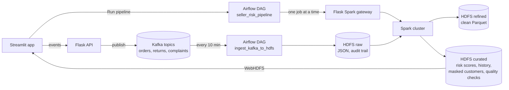
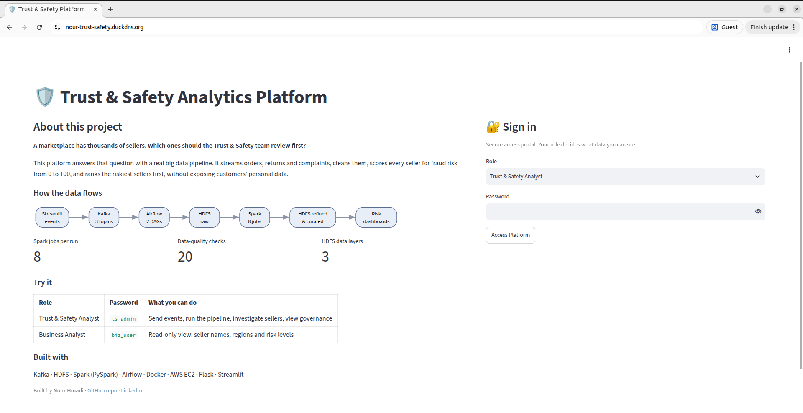
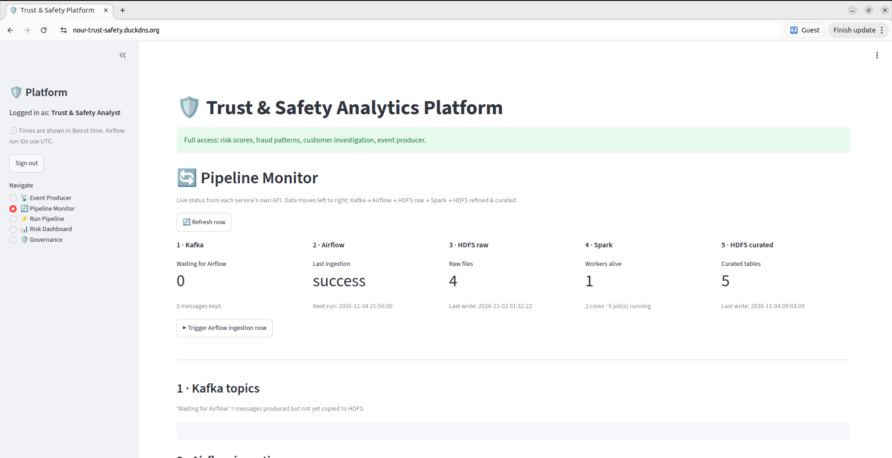
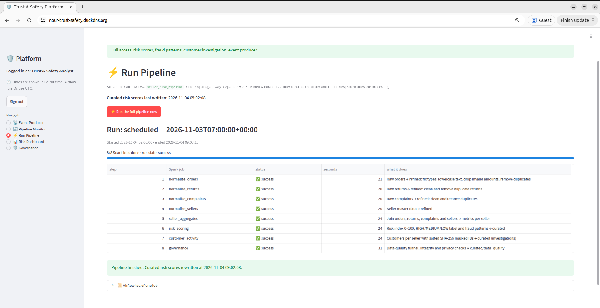
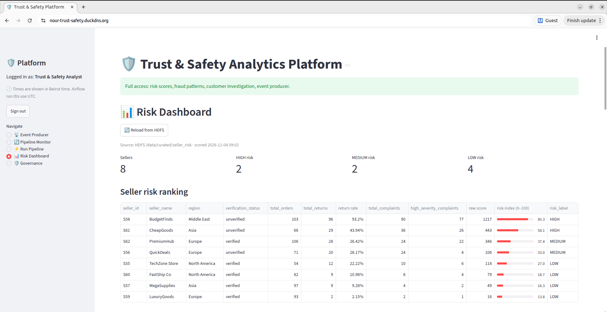
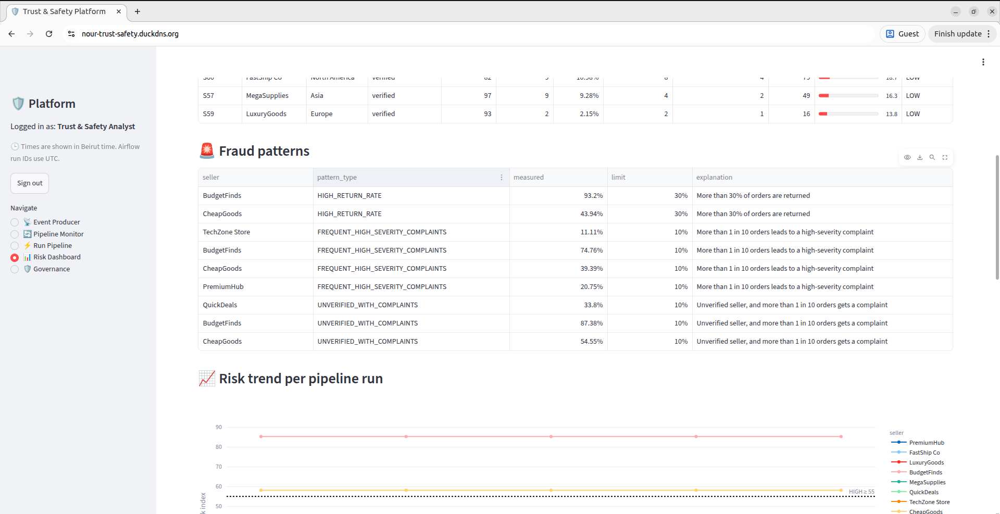
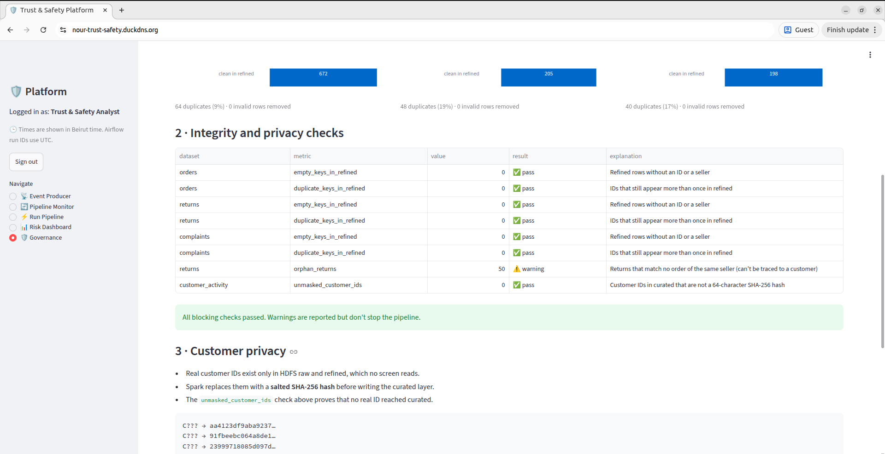
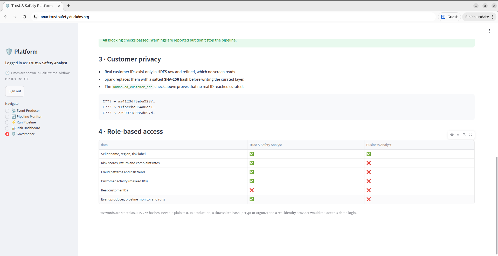

# Marketplace Trust & Safety Analytics Platform

**Live demo:** https://nour-trust-safety.duckdns.org  
Sign in as *Trust & Safety Analyst* with the password `ts_admin`.

End-to-end big data pipeline that detects risky marketplace sellers. Orders, returns and complaints stream
through **Kafka**, **Airflow** orchestrates ingestion and **Spark** processing on **HDFS**, and a role-based
**Streamlit** app shows every pipeline stage live, the resulting risk scores, and the data-governance checks.

## What it does

- **Streams events** (orders, returns, complaints) from a web form into Kafka topics
- **Ingests** new Kafka messages into HDFS every 10 minutes, with at-least-once delivery
- **Cleans and deduplicates** the data with Spark (raw → refined → curated layers)
- **Scores every seller** with a 0–100 risk index and flags fraud patterns
- **Masks customer IDs** (salted SHA-256) before any analyst can see customer activity
- **Checks data quality** on every run and stores the results
- **Separates access by role**: Trust & Safety analysts see everything, business analysts only see risk labels

## Architecture



| Layer | Technology | Role |
|---|---|---|
| Streaming | Kafka 7.4 + Zookeeper | Buffers events, keeps them 7 days, tracks what each consumer group has read |
| Storage | HDFS 3.2 (namenode + datanode) | Three data layers: raw, refined, curated |
| Processing | Spark 3.3 (master + worker) | Cleaning, deduplication, aggregation, scoring, masking, quality checks |
| Orchestration | Airflow 2.8 (LocalExecutor, Postgres) | Schedules ingestion and processing, retries, run history |
| Backend | Flask | Publishes events to Kafka; Spark job gateway for Airflow |
| Frontend | Streamlit + Plotly | Live pipeline monitor, dashboards, governance |
| Infrastructure | Docker | One container per service |

## Data layers (HDFS)

| Layer | Format | Content |
|---|---|---|
| `/data/raw/` | JSON | Every message exactly as received, never modified (audit trail) |
| `/data/refined/` | Parquet | Typed, cleaned and deduplicated orders, returns, complaints, sellers |
| `/data/curated/` | Parquet | `seller_risk`, `fraud_patterns`, `risk_history`, `customer_activity`, `data_quality` |

## The pipeline

**DAG `ingest_kafka_to_hdfs`** (every 10 minutes): one task per topic reads new messages and writes them to
HDFS raw through WebHDFS. The Kafka offset is committed only after the file is safely in HDFS.

**DAG `seller_risk_pipeline`** (daily, or on demand from the app): 8 Spark jobs.

| # | Spark job | What it does |
|---|---|---|
| 1 | `normalize_orders` | Raw orders → refined: types, lowercase text, invalid amounts dropped, duplicates removed |
| 2 | `normalize_returns` | Raw returns → refined, duplicates removed |
| 3 | `normalize_complaints` | Raw complaints → refined, duplicates removed |
| 4 | `normalize_sellers` | Seller master data → refined |
| 5 | `seller_aggregates` | Joins the four datasets into metrics per seller |
| 6 | `risk_scoring` | Risk index, risk label and fraud patterns; appends to the risk history |
| 7 | `customer_activity` | Customers per seller with salted SHA-256 masked IDs |
| 8 | `governance` | Cleaning funnel, integrity and privacy checks |

## Risk scoring

Every component is a ratio, so the index always stays between 0 and 100, whatever the seller's size.

| Component | Formula | Max points |
|---|---|---|
| Returns | returns / orders × 25 | 25 |
| Complaint volume | min(complaints / orders, 1) × 35 | 35 |
| Complaint severity | high-severity complaints / complaints × 25 | 25 |
| Verification | unverified seller | 10 |
| New seller | registered < 180 days (5) or < 365 days (2.5) | 5 |

**Labels:** HIGH ≥ 55, MEDIUM ≥ 30, LOW < 30.

Example, seller S58: 10.4 (returns) + 13.5 (complaints) + 21.4 (severity) + 10 (unverified) + 0 = **55.3 → HIGH**.

**Fraud patterns** (each flag stores the measured value and its own limit):

| Pattern | Rule |
|---|---|
| `HIGH_RETURN_RATE` | more than 30% of orders are returned |
| `FREQUENT_HIGH_SEVERITY_COMPLAINTS` | more than 1 in 10 orders leads to a high-severity complaint |
| `UNVERIFIED_WITH_COMPLAINTS` | unverified seller, and more than 1 in 10 orders gets a complaint |

## Data governance

- **Cleaning funnel**, measured on every run. Example: 9,181 raw orders → 7,525 duplicates removed →
  44 invalid rows removed → 1,612 clean orders.
- **Integrity checks**: no empty or duplicate IDs in refined; returns that can't be linked to an order of the
  same seller are reported as a warning.
- **Privacy**: real customer IDs never leave the refined layer. Spark replaces them with a salted SHA-256 hash.
  The salt is a secret in a local `.env` file, never in Git, and a check proves no unmasked ID reaches curated.
- **Role-based access**: column-level filtering. A business analyst's table is reduced to name, region and
  label before it is displayed.
- **Safe job execution**: the Spark gateway only runs jobs from an allowlist.

## The app

| Page | Role | What it shows |
|---|---|---|
| 📡 Event Producer | Trust & Safety | Send orders, returns (linked to real orders) and complaints to Kafka |
| 🔄 Pipeline Monitor | Trust & Safety | Live status of Kafka, Airflow, HDFS and Spark; trigger ingestion |
| ⚡ Run Pipeline | Trust & Safety | Start the processing DAG and watch each Spark job, with its Airflow log |
| 📊 Risk Dashboard | both roles | Risk ranking, fraud patterns, risk trend, regions, seller investigation |
| 🛡️ Governance | Trust & Safety | Cleaning funnels, integrity and privacy checks, access matrix |

## Screenshots

| **Landing page** | **Pipeline Monitor** |
|---|---|
|  |  |
| **Run Pipeline** | **Risk Dashboard** |
|  |  |
| **Fraud patterns** | **Data-quality checks** |
|  |  |
| **Privacy and role-based access** | |
|  | |

## How to run

**Requirements:** Docker with Compose v2, Python 3.10+, about 8 GB of RAM.

1. **Clone and install the Python libraries**
   ```bash
   git clone https://github.com/nour-hmadi/marketplace-trust-safety.git
   cd marketplace-trust-safety
   pip install -r requirements.txt
   ```
2. **Create your secrets** (`.env` is never committed)
   ```bash
   python3 - << 'EOF' > .env
   import base64, os, secrets
   print("MASKING_SALT=" + secrets.token_hex(16))
   print("AIRFLOW_FERNET_KEY=" + base64.urlsafe_b64encode(os.urandom(32)).decode())
   print("AIRFLOW_SECRET_KEY=" + secrets.token_hex(16))
   EOF
   ```
3. **Start the stack** (the first run builds the Airflow image)
   ```bash
   ./start_platform.sh
   ```
4. **First run only:** create the Kafka topics and load the seed data into HDFS
   ```bash
   python bootstrap.py
   ```
5. **Start the backend and the app**, each in its own terminal
   ```bash
   python3 app.py
   streamlit run streamlit_app.py
   ```
6. Open http://localhost:8501, log in as **Trust & Safety Analyst** (password `ts_admin`) or
   **Business Analyst** (`biz_user`), and click **⚡ Run Pipeline**.

To stop everything safely: `./stop_platform.sh`

| Service | URL | Login |
|---|---|---|
| Streamlit app | http://localhost:8501 | see step 6 |
| Airflow | http://localhost:8081 | admin / admin123 |
| Kafka UI | http://localhost:8080 | – |
| Spark master | http://localhost:8082 | – |
| HDFS namenode | http://localhost:9870 | – |

## Deployment

The live demo runs the full stack on a single AWS EC2 instance (`m7i-flex.large`: 2 vCPU, 8 GB RAM, Ubuntu 24.04, Stockholm region).

- **Docker Compose** runs the 11 services. `restart: unless-stopped` brings them back after a reboot.
- **systemd** runs the Flask API and the Streamlit app, and restarts them if they stop.
- **Caddy** sits in front of Streamlit as a reverse proxy and gets the HTTPS certificate from Let's Encrypt automatically. The domain is a free DuckDNS name pointing at an Elastic IP.
- **Only HTTP and HTTPS are public.** Kafka, HDFS, Spark and Airflow stay private on the server, and SSH is limited to one network with key-only login.
- **Secrets** (masking salt, Airflow keys) live in a `.env` file on the server, never in Git.
- **Pinned versions** in `requirements.txt` make a fresh install match production.

## Design decisions and limitations

- **Spark gateway instead of Apache Livy**: the Airflow image has no Spark, so Airflow asks a small Flask
  gateway to run each job. In production, Livy or a Spark-enabled Airflow image would play this role.
- **Sequential Spark jobs**: the jobs run one at a time to fit an 8 GB laptop. In production, the four
  normalize jobs would run in parallel.
- **Single datanode**: replication factor 1, one copy of each block. A production cluster runs several
  datanodes with replication factor 3.
- **Small files**: ingestion writes one small file per topic per run. A compaction DAG is planned.
- **Pending returns**: a return still waiting in Kafka is not yet known to HDFS, so its order can still be
  offered as returnable until the next pipeline run.
- **Demo login**: passwords are stored as SHA-256 hashes. A real deployment would use bcrypt or Argon2 and
  an identity provider.

## Project structure

```
├── app.py                 # Flask: event producer API + Spark job gateway
├── streamlit_app.py       # Streamlit entry point: login, roles, navigation
├── about_page.py          # public landing page shown before sign-in
├── monitor_page.py        # live status of every pipeline stage
├── pipeline_page.py       # trigger the processing DAG and watch its jobs
├── dashboard_page.py      # risk dashboard and seller investigation
├── governance_page.py     # cleaning funnel, checks, access matrix
├── pipeline_status.py     # reads the Kafka, Airflow, HDFS and Spark APIs
├── data_access.py         # reads curated Parquet from HDFS through WebHDFS
├── dags/                  # Airflow DAGs
├── spark_jobs/            # PySpark jobs
├── data/                  # seed data
├── docker-compose.yml     # the whole stack: Kafka, HDFS, Spark, Airflow
├── docker/airflow/        # Airflow image (adds the Kafka client from a local wheel)
├── bootstrap.py           # first run: Kafka topics + seed data into HDFS
├── start_platform.sh      # starts the containers in the right order
├── stop_platform.sh       # stops them safely
├── requirements.txt       # pinned versions of the Python libraries
├── docs/screenshots/      # images used in this README
└── .env.example           # secrets template (copy to .env)
```

## Author

**Nour Hmadi** · [GitHub](https://github.com/nour-hmadi) · [LinkedIn](https://www.linkedin.com/in/nour-hmadi-b86a29438)
